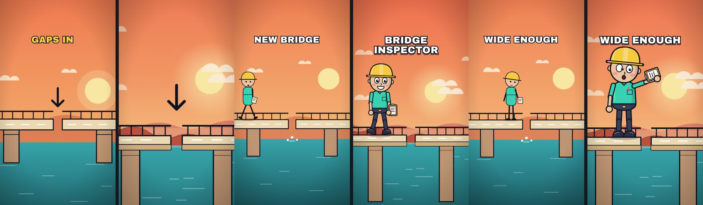
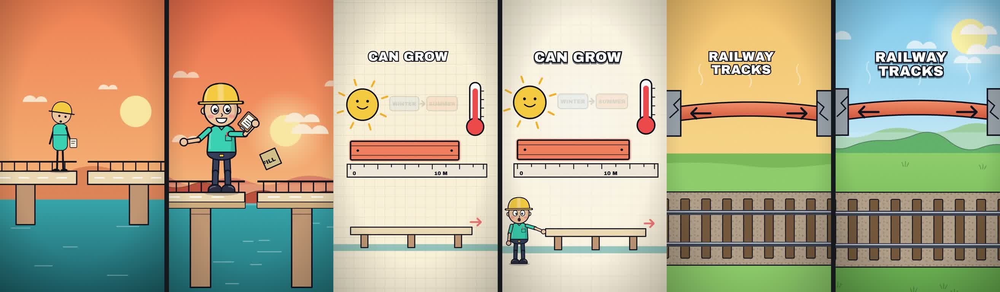
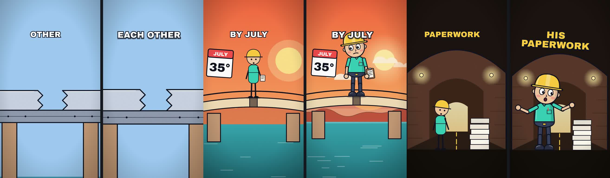
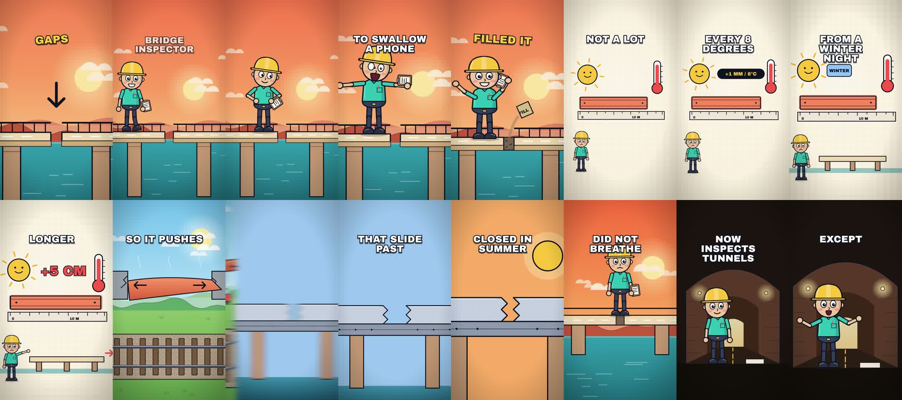
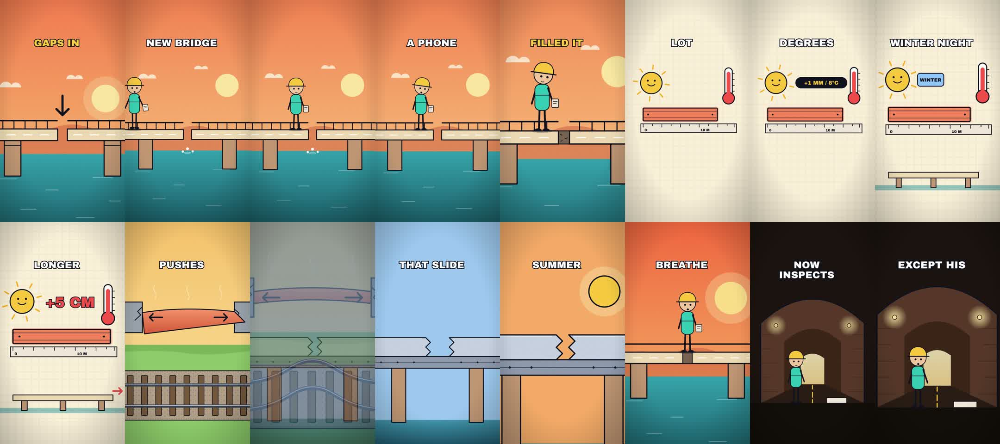

# Before / after: toonshorts 0.2.1 → 0.3.0 (22 Nov 2026)

Same story ("Why bridges have gaps"), same five recorded voice lines, same 64.3 s length, same sounds.
**Before** is the 0.2.1 short (`tutorial/assets/video/pip-short.mp4`, rendered from `forge-test/`).
**After** is 0.3.0 (`bridge-gaps-v3/renders/bridge-gaps-v3.mp4`, project in `bridge-gaps-v3/`, scenes
copied into `examples/bridge-gaps/`).

Side-by-side video (before left, after right, after's audio):
`bridge-gaps-v3/renders/before-after-side-by-side.mp4`

What went wrong in 0.2.1 is listed in [AUDIT-2026-11-22.md](AUDIT-2026-11-22.md).

## Same moments, before (left of each pair) and after (right)

Moments at 2.0 s, 6.2 s, 12.7 s: hook, Pip arrives, the phone falls through.

Moments at 17.0 s, 32.6 s, 38.9 s: he fills it, the steel grows, the track buckles.

Moments at 47.5 s, 55.2 s, 63.2 s: the joint slides, the bump, the tunnel ending.

One frame every 4 s of the after render:

Before, same sampling: 

## What changed in the picture

| | 0.2.1 | 0.3.0 |
|---|---|---|
| Character | 440 px, line limbs, dot eyes, one mouth flap | 610 px rig, outlined limbs with knees and elbows, hands, shoes, shading, brows, pupils, 6 mouth shapes |
| Acting | walk, blink, breathe wired by hand | 9 faces, 10 poses, hop, nod, look; breathe/blink/head drift automatic for every rig |
| Lip sync | open/closed per word | vowel-shaped mouths about 8 changes a second, closes to the current face |
| Backgrounds | sky, sun, hills, water redrawn by hand per scene | `<backdrop>`: 7 depth layers, drifting clouds, breathing sun glow, rippling water |
| Camera | linear 1.04x creep on every scene | eased push / pull / pan / rise with parallax per layer, plus `fx.punch` |
| Transitions | hard cut or 0.4 s fade | whip with motion blur, push-through, iris, fade; whoosh placed on the move |
| Captions | "GAPS IN", "EXCEPT HIS", "VERY FIRST" | grouped by meaning: "IN EVERY BRIDGE", "EXCEPT" / "HIS PAPERWORK"; hot words alone, bigger, tilted |
| Scenes in the bridge short | 7 | 9 (new beats: finding the gap, filling it) |

## What changed in the process

| step | 0.2.1 (audit run) | 0.3.0 (final run) |
|---|---|---|
| command | `make`, then `render`, then `stills`, each separate | `go` (one command, 9 steps, time per step) |
| sounds | 56.7 s and **failed** (Openverse timeout, nothing saved) | 0.3 s from the shared library; online search only for new sounds; a missing sound skips its cue instead of stopping the build |
| word timings | failed in the sandbox with "Command failed" | uses a temp npm cache when `~/.npm` is read-only; errors show the real cause |
| check | 12.9 s, 3 noise warnings | 14.5 s, noise warnings for one-file shorts filtered |
| preview | manual `stills --at ...` | automatic: one still per scene in a single `snaps/preview/sheet.jpg`, 11.9 s |
| render | 70.7 s, 648 lines of output | 54.1 s in the final run, 11 progress lines, one automatic retry if the browser drops its connection |
| whole run, spec to checked mp4 | could not finish without hand-copying sounds | **88.1 s**, QA PASS |

Real timings of the final `toonshorts go bridge-gaps-v3` (voice and word timings were already done):
voice 0 s, words 0 s, sfx 0.3 s, build 0.3 s, check 14.5 s, preview 11.9 s, mix 0.7 s, render 54.1 s, QA 6.2 s.
Render time moves around between runs: earlier renders of the same project took 73.4 s and 66.1 s, and one
run failed with a dropped browser connection (that is why the retry exists).

A new project from the starter template (`init`, then `go --no-render`) ran end to end in 25.9 s, after
local Kokoro voice (17.9 s, first run) and with whisper word timings (10.2 s).

QA of the final render: **PASS**: −14.3 LUFS, true peak −1.3 dBFS, 0 black segments, 0 frozen segments,
0 silences over 1.5 s.

Scene files: the two plain bridge scenes went from 35 and 52 lines to 22 and 21 lines, because the world,
the life and the camera now come from the engine. The diagram scenes (steel, push, joint) kept their
hand-made art and got a backdrop, a guide character and new camera work. In total the 9 new scenes are
368 lines against 346 for the old 7.

## Still weak (honest list)

- The rig only faces front. Walking sideways is a front-facing shuffle; a side or 3/4 view would make walks
  and pointing read much better.
- The diagram scenes (steel bar, rails, joint) are still drawn by hand in each scene. There is no prop
  library yet (bridge deck, rails, thermometer, calendar).
- The expansion-joint scene (s7) is still a flat sky with no character in it.
- Lip sync guesses mouth shapes from letters, not from real phonemes.
- Parallax applies to the engine's scene move only; `fx.cam` pushes still scale every layer the same.
- Captions still split some phrases oddly ("ON HIS VERY FIRST" / "DAY").
- `hyperframes check` and the render take 15-75 s and dominate the run; the engine cannot speed those up.
- Story and scene writing is still Claude's job through the skill: `go` starts from a written spec, not from
  a one-line prompt.
